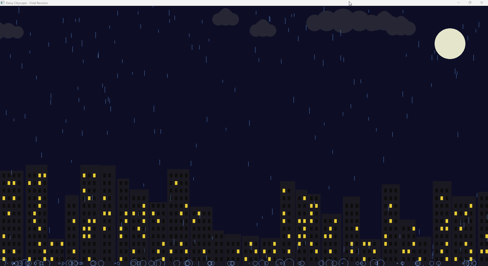

# 🌧️ Rainy Cityscape (OpenGL)

A visually dynamic **rainy city simulation** built using **C++ and OpenGL (GLUT)**.
This project demonstrates classic computer graphics algorithms like **DDA Line Drawing** and **Midpoint Circle Algorithm**, combined with animation, lighting effects, and interactive controls.

---

## ✨ Features

* 🌙 **Day/Night Toggle** (Moon ↔ Sun)
* 🌧️ **Dynamic Rain System** (Adjustable intensity)
* 💥 **Lightning Effects** with randomized paths
* ☁️ **Animated Clouds** (Multiple styles)
* 🏙️ **Procedurally Generated City Skyline**
* 💡 **Randomly Lit Windows**
* 🌊 **Rain Ripples / Splashes**
* ⏯️ **Pause / Resume Simulation**
* 🎨 **Pixelated vs Smooth Rendering Modes**

---

## 🧠 Algorithms Used

### 1. DDA Line Algorithm

Used for:

* Rain streaks
* Lightning bolts

```cpp
void drawLineDDA(float x1, float y1, float x2, float y2)
```

---

### 2. Midpoint Circle Algorithm

Used for:

* Rain ripples
* Moon outline

```cpp
void drawCircleMidpoint(int xc, int yc, int r)
```

---

### 3. Filled Circle (Custom + OpenGL)

Used for:

* Moon / Sun
* Clouds

```cpp
void drawFilledCircle(int xc, int yc, int r)
void drawSmoothFilledCircle(float cx, float cy, float r, int segments)
```

---

## 🎮 Controls

| Key       | Action                             |
| --------- | ---------------------------------- |
| `r`       | Regenerate city skyline            |
| `+`       | Increase rain intensity            |
| `-`       | Decrease rain intensity            |
| `n` / `d` | Toggle Night / Dusk                |
| `s`       | Toggle rain splashes               |
| `c`       | Toggle clouds                      |
| `m`       | Toggle pixelated/smooth moon & sun |
| `SPACE`   | Pause / Resume                     |
| `ESC`     | Exit                               |

---

## 🏗️ Project Structure

```bash
.
├── main.cpp        # Full implementation
├── README.md       # Documentation
```

---

## ⚙️ Installation & Run

### 🐧 Linux

```bash
g++ main.cpp -lGL -lGLU -lglut -o rainy
./rainy
```

### 🪟 Windows (MinGW)

```bash
g++ main.cpp -lfreeglut -lopengl32 -lglu32 -o rainy.exe
rainy.exe
```

### 🍎 macOS

```bash
clang++ main.cpp -framework OpenGL -framework GLUT -o rainy
./rainy
```

---

## 🎨 Rendering Pipeline

```
User Input → State Update → Physics/Animation → Algorithms → Rendering
```

* **Input** → Keyboard controls
* **State** → Toggles (night, rain, clouds)
* **Update Loop** → Movement & effects
* **Algorithms** → DDA, Midpoint Circle
* **Rendering** → Double buffering (`glutSwapBuffers`)

---

## 🚀 Highlights

* Real-time animation (~60 FPS)
* Procedural generation (city, clouds, lightning)
* Clean separation of:

  * Input
  * Simulation
  * Rendering
* Efficient memory handling using `std::vector`

---


## 🎬 Demo


> A dark stormy skyline with rain, lightning flashes, moving clouds, and glowing windows.

---

## 📚 Learning Outcomes

* Implementation of **classic rasterization algorithms**
* Understanding **OpenGL rendering pipeline**
* Event-driven programming with **GLUT**
* Real-time animation and simulation techniques

---

## 🧑‍💻 Author

**Ashrafuzzaman Khalid**

---
